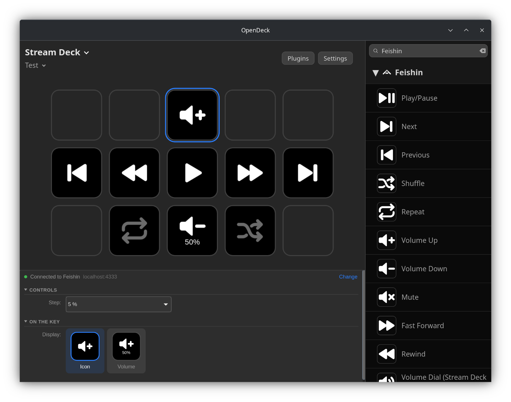

<p align="center">
  
</p>

<h1 align="center">Feishin for Stream Deck</h1>

<h3 align="center">Control your music from your Stream Deck.</h3>

<p align="center">
  Play, skip, seek and set the volume in <a href="https://github.com/jeffvli/feishin">Feishin</a>. For the Stream Deck app and for <a href="https://github.com/nekename/OpenDeck">OpenDeck</a> on Linux.
</p>

<h5 align="center">
  <a href="#install">Install</a> |
  <a href="#how-to-use">How to use</a> |
  <a href="#actions">Actions</a> |
  <a href="https://github.com/FeloDeck/Feishin-Plugin/issues">Report a bug</a>
</h5>

<p align="center">
  <a href="https://ko-fi.com/felitendo"></a>
</p>

<p align="center">
  
</p>

## Install

You need the Feishin desktop app and Stream Deck 7.1 or newer on Windows 10+ or macOS 12+. On Linux, use OpenDeck with Node.js 20 or newer.

Get it from the [Elgato Marketplace](https://marketplace.elgato.com/product/feishin-d55fd48d-f102-4d21-83ce-bc1ea12beeba).

<details>
<summary>OpenDeck, or a plugin file</summary>

Download the `.streamDeckPlugin` file from the [latest release](https://github.com/FeloDeck/Feishin-Plugin/releases/latest). In OpenDeck, install it on the **Plugins** page. In the Stream Deck app, double-click it.

</details>

<details>
<summary>Build it yourself</summary>

```bash
npm install
npm run build        # builds de.felitendo.feishin.sdPlugin/bin/plugin.js
npm run pack         # creates dist/de.felitendo.feishin.streamDeckPlugin
```

`npx streamdeck link de.felitendo.feishin.sdPlugin` installs it in the Stream Deck app, and `npm run watch` rebuilds it on every change.

</details>

## How to use

1. In Feishin, open **Settings → Window → Remote** and turn on **Enable remote control server**.
2. Set the username to `feishin` and the password to `streamdeck`. Keep the port at `4333`.
3. Drag an action from **Feishin** onto a key.

You use other login details, another port, or Feishin runs on another PC? Click **Change** next to the connection status at the top of any key's settings. The settings apply to all keys.

If something is wrong, the settings tell you what to do, and the keys show **Feishin offline** or **Password?**. A warning on a key after a press means the command did not reach Feishin.

Feishin only reports its volume after the volume changes. If a volume key says the volume is unknown, change the volume in Feishin once.

## Actions

<details>
<summary>All 12 actions</summary>

| Action | What it does |
|---|---|
| Play/Pause | Play or pause. Shows the time left or played. |
| Next | Play the next track. |
| Previous | Play the previous track. |
| Shuffle | Turn shuffle on or off. |
| Repeat | Repeat off, repeat all or repeat one. |
| Volume Up | Volume up. Hold to keep going. Shows the volume. |
| Volume Down | Volume down. Hold to keep going. Shows the volume. |
| Mute | Mute or unmute. |
| Fast Forward | Jump 5 to 60 seconds ahead. Hold to keep going. |
| Rewind | Jump 5 to 60 seconds back. Hold to keep going. |
| Volume Dial (Stream Deck +) | Turn for volume, press to mute. |
| Seek Dial (Stream Deck +) | Shows the track and how far it is. Turn to seek, press to play or pause. |

Play/Pause, Shuffle and Repeat show what Feishin is doing. The time and the volume can go above or below the icon, or you can hide them. Everything is in English and German.

</details>

## Credits

To the [Feishin](https://github.com/jeffvli/feishin) developers, and to the OpenDeck developers.

GPL-3.0-only.
